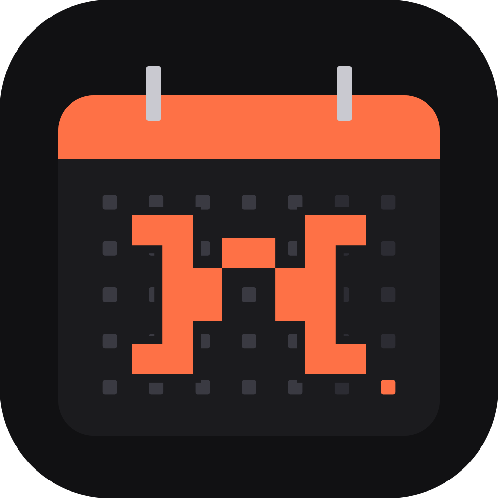

<p align="center">
  
</p>

<h1 align="center">Nadendar</h1>

<p align="center">
  <b>Le calendrier de nads.</b><br>
  Toute la famille, ses plannings et ses rendez-vous dans un calendrier animé, à plugins.<br>
  Windows · Linux · Android — 100 % local, aucun compte.
</p>

---

Nadendar suit le style de nads.site et de NadsPDF : socle presque noir, panneaux flottants
arrondis, police Onest, accent orange. Le logo reprend la marque nads.site, posée sur une page de
calendrier dont les jours sont de petits carrés pixel.

## ✨ Ce qu'il fait

**Vues** — Mois, Semaine, Jour, Agenda, plus celles qu'ajoutent les plugins (Planning, Budget, Gantt).
Glisser-déposer des événements (au quart d'heure), double-clic pour créer, récurrences, rappels.

**Personas** — chaque membre de la famille a un avatar façon Notion (genre, coiffure, peau,
lunettes, barbe), une couleur et un profil (adulte, ado, enfant, bébé, senior). Sur chaque jour,
une pastille *avatar + icône* dit qui travaille et comment : 🌅 matin, 🌇 après-midi, 🌙 nuit,
☀️ journée, 💻 télétravail, 🌴 congé…

**Imprimer / PDF** (`Ctrl+P` ou l'icône imprimante) — Mois, Semaine ou Planning de travail, de 1
à 12 pages, personas au choix, fond clair ou sombre. Chaque page est un A4 paysage à taille fixe :
les cases ne sont jamais coupées, ce qui ne tient pas est résumé en « +N autres ». Le PDF est
généré dans l'application (aussi sur Android) et enregistré dans Téléchargements.

## 🧩 Plugins (activables un par un)

| Plugin | Ce qu'il fait | Lié à |
|---|---|---|
| Planning de travail | Rythmes répétés : bureau 5/2, hybride, 2×8, 3×8 usine, 5×8, 4/3, 12 h, nuit fixe, ou rythme sur mesure. Congés payés, RTT, arrêts, formation (glisser sur la vue Planning). Repos les jours fériés. | Livraisons, Budget |
| Réunions & RDV | Meet, Teams, Zoom, Doctolib, WhatsApp, téléphone : lien reconnu automatiquement, bouton « Rejoindre », compte à rebours. | Mails |
| Planning scolaire | Emploi du temps de chaque enfant, vacances scolaires officielles (zone A/B/C/Corse) qui suspendent les cours. | Fournitures |
| Cycle menstruel | Intégré au persona : règles, fenêtre fertile, ovulation estimées, moyenne observée, mode discret. | |
| Anniversaires | Depuis la date de naissance des personas, avec l'âge. | |
| Météo | Open-Meteo, 16 jours dans les cases, détail heure par heure. | |
| Lune & soleil | Phases de lune réelles, lever/coucher, heures de nuit grisées dans les vues horaires. | |
| Jours fériés | France, calculés (Pâques, Ascension, Pentecôte…). | Planning |
| To-do list | Saisie rapide « Appeler la mairie demain @Léa !! ». | Mails |
| Courses & fournitures | Listes triées par rayon, jour et personne qui s'en charge. | Menus |
| Menus de la semaine | Midi/soir ; les ingrédients partent dans la liste de courses. | Courses |
| Livraisons | Transporteur, suivi, créneau, qui récupère — **alerte si la personne travaille** sur le créneau, avec les disponibilités de chacun. | Planning |
| Dépenses & salaires | Revenus/dépenses récurrents, solde cumulé, catégories, **salaire estimé depuis les heures du planning**. | Planning |
| Diagramme de Gantt | Projets : glisser, étirer, lier les tâches, avancement, affichage dans le calendrier. | To-do |
| Mails liés | Glisser un `.eml` ou coller un mail : date, heure et lien visio détectés → événement ou tâche. | Réunions |

Ajouter un plugin = un fichier dans `src/plugins/` qui implémente l'interface `Plugin`
(`src/plugins/types.ts`) puis une ligne dans `src/plugins/registry.ts`. Un plugin peut fournir des
éléments de calendrier, des badges de jour, des pastilles persona, des plages grisées, un panneau,
une vue, une section de fiche persona, un résumé de jour et un élément de barre d'état.

## ⌨️ Raccourcis

`Ctrl+K` recherche · `Ctrl+P` imprimer / PDF · `T` aujourd'hui · `←/→` précédent/suivant · `M` mois · `S`/`W` semaine ·
`J`/`D` jour · `A` agenda · `N` nouvel événement

## 🛠️ Développer

```bash
pnpm install
pnpm dev            # aperçu navigateur sur http://localhost:1420
pnpm app:dev        # application Tauri (fenêtre native)
pnpm app:build      # installeur Windows (.exe NSIS + .msi) ou paquets Linux (.deb, .AppImage, .rpm)
pnpm icons          # régénère toutes les icônes depuis scripts/make-icon.mjs
```

**Android** : il faut Android Studio (SDK + NDK) et Java 17, puis `pnpm android:init` une fois et
`pnpm android:build`. Sans environnement Android local, la CI GitHub
(`.github/workflows/build.yml`) construit l'APK, ainsi que Windows et Linux, à chaque tag `v*`.

**Données** : tout est stocké sur l'appareil. Réglages ▸ Exporter / Importer pour passer du PC au
téléphone.

## 📦 Pile

Tauri 2 (Rust) · React 19 · TypeScript · Vite · Tailwind CSS 4 · Framer Motion · Zustand ·
date-fns · SunCalc · Open-Meteo · open data Éducation nationale.
